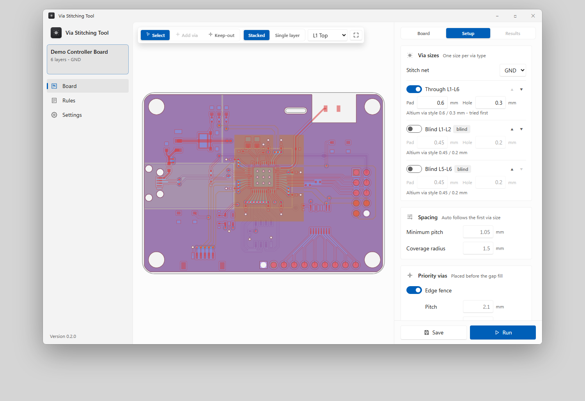

# Via Stitching Tool

**Places GND stitching vias on a finished Altium PCB layout wherever they legally fit, then sends them back to Altium.** 
Windows 10 and 11 - 64-bit

 

<a href="https://github.com/branggs/Via-Stitching-Tool-Release/releases/latest/download/Via-Stitching-Tool-Windows-Setup.exe">
  <picture>
    <source media="(prefers-color-scheme: dark)" srcset=".github/assets/download-windows-dark.svg">
    
  </picture>
</a>

Version 0.2.0 (preview) - <a href="https://github.com/branggs/Via-Stitching-Tool-Release/releases">All versions</a>

  

<picture>
  <source media="(prefers-color-scheme: dark)" srcset=".github/assets/review-dark.png">
  
</picture>

## What you can do

- Try it straight away on the built-in demo: a 6-layer controller board with power pours, USB and RF traces and blind vias
- Export the open PCB from Altium with the Export for Stitching script, then open the board file here
- Place vias off-grid wherever they fit: edge fences, fences along picked nets, return vias, island anchors and gap fill, with through and optional blind vias - and watch them appear on the board as the stitcher runs
- Pick how far to stitch on a coverage curve: Light, Standard or Dense, or drag the cut-off
- See coverage per layer as a heat map, where vias may go, and areas no via can reach
- Add, delete and lock vias by hand with Altium-style mouse and keys; each via is checked again before export, and a click on a problem jumps to it
- Use the board's own rules or an imported Altium .RUL file, and compare the two
- Export the via list for the Import Stitching Vias script, and an HTML review report

Altium DRC stays the final check: run it after importing the vias.

<picture>
  <source media="(prefers-color-scheme: dark)" srcset=".github/assets/setup-dark.png">
  
</picture>

<picture>
  <source media="(prefers-color-scheme: dark)" srcset=".github/assets/review-heat-dark.png">
  
</picture>

## Install

1. Download and run `Via-Stitching-Tool-Windows-Setup.exe`.
2. Windows may show a SmartScreen warning because the installer is not code-signed yet: choose **More info**, then **Run anyway**.
3. Open Via Stitching Tool from the Start menu.

This preview does not update itself yet: install a newer version over it to update.

## What's new in 0.2.0

NEW
- One workspace: the board stays in view while you set up, run and review
- Watch the vias appear on the board while the stitcher runs
- Click a check failure, an unreachable area or a skipped via to jump to it
- Altium-style controls: scroll and Shift+scroll pan, Ctrl+scroll zooms, right-drag pans, Shift+S shows one layer, numpad + and - step layers
- Box select: drag right for everything the box touches, drag left for vias fully inside

IMPROVED
- Via sizes are set at the top of Setup; blind vias start off and have their own size
- Vias stay fully inside the GND plane - no pads poking into the pullback at the board edge or around holes

FIXED
- Esc or a right-click leaves the Add via and Keep-out tools

[All releases and notes](https://github.com/branggs/Via-Stitching-Tool-Release/releases)
