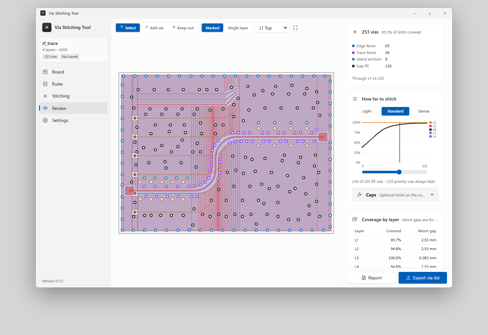
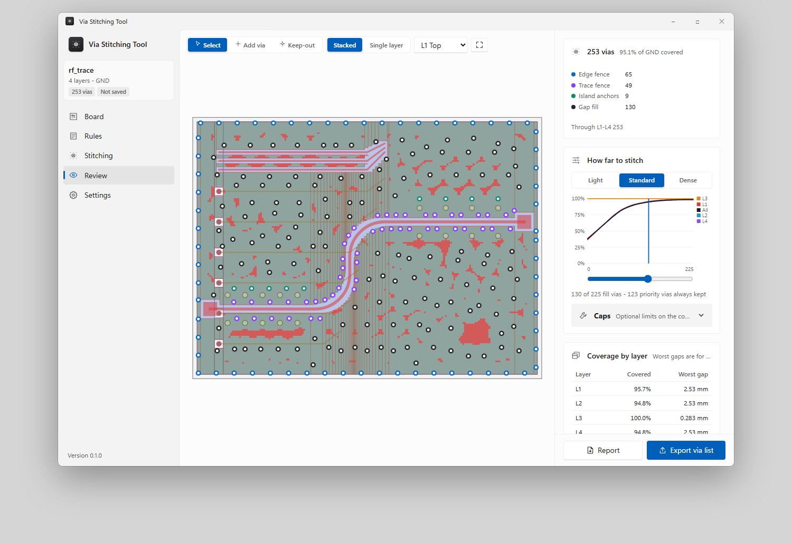

# Via Stitching Tool

**Places GND stitching vias on a finished Altium PCB layout wherever they legally fit, then sends them back to Altium.** 
Windows 10 and 11 - 64-bit

 

<a href="https://github.com/branggs/Via-Stitching-Tool-Release/releases/latest/download/Via-Stitching-Tool-Windows-Setup.exe">
  <picture>
    <source media="(prefers-color-scheme: dark)" srcset=".github/assets/download-windows-dark.svg">
    
  </picture>
</a>

Version 0.1.0 (preview) - <a href="https://github.com/branggs/Via-Stitching-Tool-Release/releases">All versions</a>

  

<picture>
  <source media="(prefers-color-scheme: dark)" srcset=".github/assets/review-dark.png">
  
</picture>

## What you can do

- Export the open PCB from Altium with the Export for Stitching script, then open the board file here
- Place vias off-grid wherever they fit: edge fences, fences along picked nets, return vias, island anchors and gap fill, with through and blind vias
- Pick how far to stitch on a coverage curve: Light, Standard or Dense, or drag the cut-off
- See coverage per layer as a heat map, where vias may go, and areas no via can reach
- Add, delete and lock vias by hand; each via is checked again before export
- Use the board's own rules or an imported Altium .RUL file, and compare the two
- Export the via list for the Import Stitching Vias script, and an HTML review report

Altium DRC stays the final check: run it after importing the vias.

<picture>
  <source media="(prefers-color-scheme: dark)" srcset=".github/assets/review-heat-dark.png">
  
</picture>

## Install

1. Download and run `Via-Stitching-Tool-Windows-Setup.exe`.
2. Windows may show a SmartScreen warning because the installer is not code-signed yet: choose **More info**, then **Run anyway**.
3. Open Via Stitching Tool from the Start menu.

This preview does not update itself yet: install a newer version over it to update.

## What's new in 0.1.0

NEW
- First preview: board viewer, rules and .RUL import, stitching setup, review with coverage curve, manual edits, export, projects and presets

[All releases and notes](https://github.com/branggs/Via-Stitching-Tool-Release/releases)
